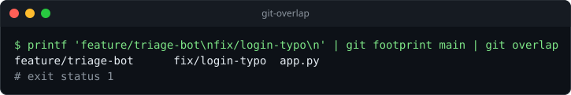
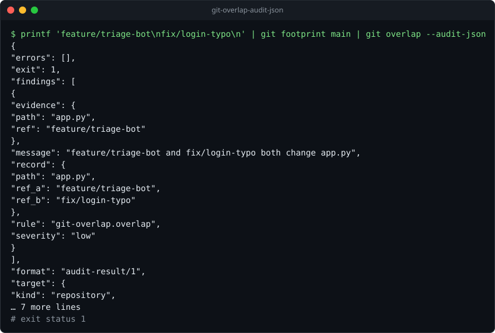

# git-overlap

git-overlap is a package of three git commands: `git footprint`, `git overlap` and
`git pairmerge`. Installing it puts `git-footprint`, `git-overlap` and `git-pairmerge` on your
`PATH`; git runs any `git-NAME` program on `PATH` as `git NAME`, so no configuration is needed.

Several branches, often from AI agents working in parallel, edit the same few files. Each
branch is fine alone, but when one lands the others conflict or must be re-tested, so landing
them one at a time multiplies CI runs and agent time. git-overlap shows, before any merge, which
branches change the same files and which pairs really conflict, so they can be batched,
reordered or fixed first.

git-overlap was inspired by Xuchen Yao's article
["Rethinking Merging and Continous Integration for Agentic Workflows"](https://www.linkedin.com/pulse/rethinking-merging-continous-integration-agentic-workflows-xuchen-yao-jkaxc/)
(4 November 2026). It covers the measurement side the article calls for; see
[Relation to the article](https://github.com/jacob-adm/git-overlap/blob/main/docs/article.md).

## Example output

A demo repository with two branches that both edit `app.py`:



The same pair with `--audit-json` (first lines of the result):



## Requirements

- Python 3.9 or later, standard library only.
- git 2.38 or later. `git pairmerge` needs git 2.43 or later; on an older git it exits 2 with a
  message naming 2.43. git must be an executable named `git` on `PATH`.
- Linux, macOS and Windows, all tested in CI.
- The examples are POSIX `sh`; on Windows, run them from Git Bash. Windows has two further
  limits on refs and git shims; see [Limitations](https://github.com/jacob-adm/git-overlap/blob/main/docs/limitations-and-security.md#limitations).

## Install

From PyPI:

```
pip install git-overlap
```

From a clone:

```
git clone https://github.com/jacob-adm/git-overlap
cd git-overlap
pip install .
```

Either way pip installs `git-footprint`, `git-overlap` and `git-pairmerge` as console scripts.
If git answers that `footprint` is not a git command, the directory pip installs scripts into is
not on `PATH`. Check the install:

```sh
git footprint --version
```

```text
git-footprint 0.7.0
```

Use `-h` for usage: `git footprint --help` is answered by git itself, which looks for a manual
page. Without installing, each command also runs from a clone as
`python3 -m git_overlap.footprint` (and `.overlap`, `.pairmerge`).

## How it works

1. **List the branches.** Pipe the branch names in, one per line, for example from
   `git for-each-ref`. Each command reads tab-separated lines and writes tab-separated lines, so
   the output of one is the input of the next. Add `--json` to the last command to get its
   records as a JSON array instead, for a CI script or an agent; see
   [JSON output](https://github.com/jacob-adm/git-overlap/blob/main/docs/commands.md#json-output).
2. **`git footprint BASE`: what each branch changes.** For each branch it lists every file the
   branch changes since it left BASE, the same list a pull request's "files changed" shows. A
   rename counts as deleting the old path and adding the new one.
3. **`git overlap`: which branches touch the same files.** It pairs every two branches that
   change the same file, or a file and a path under it (`foo` and `foo/bar`). It only reads its
   input and runs no git. A pair listed here may still merge cleanly.
4. **`git pairmerge`: which pairs really conflict.** For each pair it runs the merge in memory
   with `git merge-tree --write-tree` and prints `clean`, or `conflict` with each conflicted file.
   Nothing is checked out and nothing is written to the repository. With `--onto BASE`, it asks
   whether the two would conflict if both landed on BASE, one after the other, and marks a branch
   that no longer merges into BASE as `stale`.
   To include work that is not committed yet, name a worktree as `worktree:PATH` in place of a
   branch: it stands for the files in that worktree as they are now. Nothing is written to the
   repository to do this. See [Commands](https://github.com/jacob-adm/git-overlap/blob/main/docs/commands.md).
5. **Act on the result.** Like `grep` and `diff`, `git overlap` and `git pairmerge` exit 1 when
   they find something, 0 when they find nothing and 2 on an error, so a script or CI job can
   stop on it. Batch, reorder or fix the conflicting branches before merging them.

## Commands

```
git footprint [-z] [--json] BASE < refs
git overlap [-z] [--json | --audit-json] [--with REF] < footprint
git pairmerge [-z] [--json | --audit-json] [--attributes FILE] [--onto BASE] < pairs
```

Each command reads tab-separated records on standard input and writes them on standard output.
`-z` uses NUL-terminated records and `--json` writes a JSON array; `--audit-json` writes one
object in the audit result format shared with other audit tools. See
[Commands](https://github.com/jacob-adm/git-overlap/blob/main/docs/commands.md) for the fields,
`worktree:PATH` refs and exit status.

## Quick start

Inside the repository to check, list its branches one per line and pipe them through the three
commands. Replace `main` with the base branch and `refs/heads/agent/` with the refs to check,
for example `refs/remotes/origin/` for every branch fetched from `origin`. Below, the commands
run in the [example repository](https://github.com/jacob-adm/git-overlap/blob/main/docs/commands.md#example-repository).

```sh
git for-each-ref --format='%(refname:short)' refs/heads/agent/ |
  git footprint main | git overlap | git pairmerge --onto main | cut -f1-3 | uniq
```

```text
agent/a	agent/b	conflict
agent/a	agent/c	conflict
agent/a	agent/d	conflict
agent/b	agent/c	conflict
agent/b	agent/d	conflict
agent/c	agent/d	conflict
agent/f	agent/g	stale
```

Each line is a pair of branches that conflict when both land on `main`, one after the other. Drop
`| cut -f1-3 | uniq` to see the conflicted files. `agent/e` shares no file with any other
branch, so `git overlap` passes on no pair that includes it and `git pairmerge` never merges it.
`agent/f` no longer merges into `main`, so its pair is `stale`, not a conflict; the
[Stale branches](https://github.com/jacob-adm/git-overlap/blob/main/docs/recipes.md#stale-branches-which-branches-no-longer-merge-into-the-base)
recipe finds such branches. Without `--onto main`, each pair is merged at its own merge base,
where `agent/f` and `agent/g` conflict because `agent/g` carries the change to `main` that
`agent/f` conflicts with.

Output read on a terminal shows control bytes in names as `\xHH`; output piped to another program
is always the raw bytes.

## Documentation

- [Commands](https://github.com/jacob-adm/git-overlap/blob/main/docs/commands.md): each command's input, output, options and exit status, with
  examples.
- [Recipes](https://github.com/jacob-adm/git-overlap/blob/main/docs/recipes.md): pipelines that find hotspots, measure p and test merge drivers.
- [Use cases](https://github.com/jacob-adm/git-overlap/blob/main/docs/use-cases.md): real runs on three public repositories, with recorded output
  and timings.
- [Limitations and security](https://github.com/jacob-adm/git-overlap/blob/main/docs/limitations-and-security.md): what the commands miss, read
  and write.
- [Using it with other tools](https://github.com/jacob-adm/git-overlap/blob/main/docs/other-tools.md): tested stacks with git surface, trust-path
  and pr-merge-audit, line-oriented tools and bug-age.
- [Relation to the article](https://github.com/jacob-adm/git-overlap/blob/main/docs/article.md): what the article finds and which parts are
  covered.
- [SPEC.md](https://github.com/jacob-adm/git-overlap/blob/main/SPEC.md): the full reference: every option, record format, error and edge case.

## Licence

Apache-2.0; see `LICENSE`.
